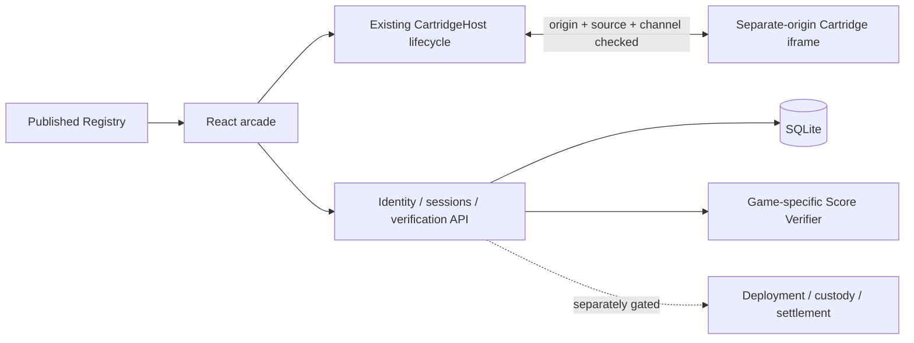

# Token Arcade v0 — architecture

**Label: Implementation Note.** Read the [Documentation Index](token-arcade-package/Token_Arcade_Documentation_Index.pdf) first. The Product Handoff owns product behavior; Economy v0.2.2 owns money, liquidity, fees, prizes and protocol authority. Cartridge Kit v0.3 and this repository's notes are subordinate to both.

## Ownership boundaries



A **Skeleton** is reusable gameplay code. A **Cabinet** is one deployment: `manifest.id` / `gameId`, published version/artifact, community metadata, economy, leaderboard, scores and raids. Reusing a Skeleton/adapter never merges these records. Passport aggregates a player's cabinet history; public boards remain cabinet-specific.

- `apps/web`: arcade, cabinet/player, Passport, raids, Creator Portal and Admin Review Console. The shelf renders published records from `GET /api/games`.
- `apps/api`: verified identity, publication state, server-issued competition sessions, attempts, result acceptance and projections. SQLite provides durable local storage.
- `packages/sdk`: existing `TokenArcadeGame`, `GameRunConfig`, `GameRunResult`, manifest and verifier interfaces. `IframeCartridge` transports that same lifecycle across origins; the classic browser bridge is its transport peer.
- `cartridges`: vendored, pinned source adaptations. Games own simulation, input, rendering, sound and local progression. They receive no Privy token, wallet, private key or economic execution capability.
- `scripts/cartridges.mjs`: local separate-origin artifact server and narrow public Coindle data proxy. Production must serve immutable reviewed artifacts on an approved HTTPS origin.
- `contracts`: earlier onchain prototype/tooling, not a completed Economy v0.2.2 implementation.

## Lifecycle and isolation

The host mounts, subscribes to normalized results, starts, pauses/resumes and destroys each game. Pending mounts are destroyed immediately on navigation. Each frame receives a unique handshake channel. Both ends check the exact sender window and origin. The iframe uses a separate origin and restricted sandbox; a query parameter alone cannot authorize embedding because the game origin also serves an explicit host allowlist.

Blur/hidden-tab pauses require explicit resume. Leaving removes the iframe and host listeners and invokes adapter cleanup. Free Play keeps native post-run screens/local progression; native restarts receive a fresh local run ID. Competitive sessions cannot restart into a second score using the same issued session.

## Roles and publication

```text
creator submits → submitted → admin validates → approved
     ↑                           |                 |
     └── rejection/revision ─────┘                 v
                                             creator deploys
                                                   |
                                                published
                                                   |
                                              admin pauses
```

Guest play needs no account. Player/creator identity comes from Privy; admin access is an API-checked allowlist. Local demo identities work only when explicitly configured on loopback. Creator revisions invalidate approval. Only the owning creator can deploy an approved submission. Admin approval and the former direct-publish endpoint cannot bypass that action.

The four reviewed legacy imports have one explicit bootstrap path, marked `platform:legacy-import`. Later submissions use the real lifecycle. New Free Play artifacts need no hardcoded frontend adapter. Admission checks version path, approved separate origin, manifest, controls and manual technical validation. Admins must build/play/review the source and artifact before attesting checks; a checkbox records review, rather than performing it automatically.

## Verification and board identity

Ranked/Raid requires an account, published mode, installed verifier, and server-issued `runId`, version, seed, rules and expiry. The API binds results to identity and cabinet, validates shape, replaces untrusted rules with issued rules, verifies gameplay, and atomically consumes the session. Raid attempts count issuance, including abandoned runs. Expired, reused, altered-version and paused-cabinet submissions are rejected.

`GameVerifier` accepts session checks, server-authoritative judging or replay. Replay is used where the game supports it well; it is not mandatory for future games. Free Play results never become verified leaderboard entries. Boards partition by cabinet, mode, version, objective and issued rules; raids add their own ID.

## API additions

| Route | Purpose |
| --- | --- |
| `GET /api/games` | Published public cabinets |
| `GET/POST /api/creator/games` | Own submissions / submit |
| `PATCH /api/creator/games/:id` | Revise own unpublished submission, resetting review |
| `POST /api/admin/games/:id/validate` | Record build, mount, cleanup, result, mobile and source review evidence |
| `POST /api/admin/games/:id/approve` | Approve reviewed artifact; does not publish |
| `POST /api/admin/games/:id/reject` | Return feedback |
| `POST /api/creator/games/:id/deploy` | Owner publishes approved cabinet |
| `POST /api/admin/games/:id/publish` | Retired: rejects direct publication |
| `POST /api/runs`, `POST /api/runs/:id/complete` | Issue/verify competition session |
| `GET /api/leaderboards/:gameId` | Cabinet standings |
| `GET /api/coindle/prices`, `/live`, `/history` | Bounded data; key stays server-side |

Existing Passport, linked-wallet proof, admin configuration and raid routes remain. Publication actions do not deploy contracts or spend funds.

## Economy boundary

`communityConcept` describes an association separately from an executable `community` asset. `economy` records coming-soon/pending/enabled status without changing cabinet identity. An eMONAD reference address, Skrumpeys association or ETH/WETH concept is not permission to execute a strategy or deploy a coin.

Economy v0.2.2 §11 requires a complete controlled economy deployment (including pool/hook/LP policy), not just minting a token. The earlier factory route does not satisfy that requirement. This integration leaves that gap explicit and prevents pending launch economies from using the legacy token-only action. Coindle can later attach an approved economy to its current ID without losing history. Paid entry is outside v0; free/no-prize raids exercise score infrastructure. Custody, payouts and economy funding remain blocked pending protocol implementation and verified assets.
